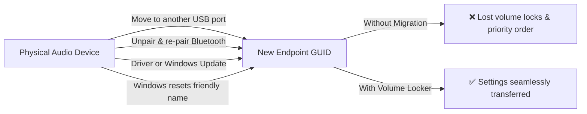
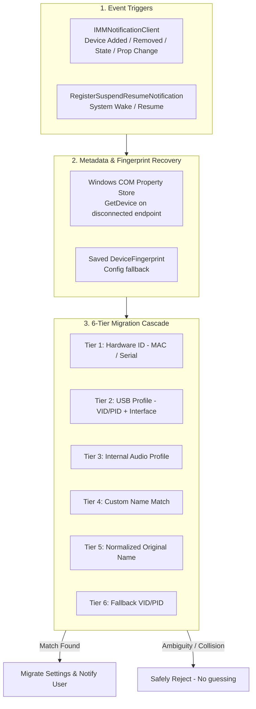
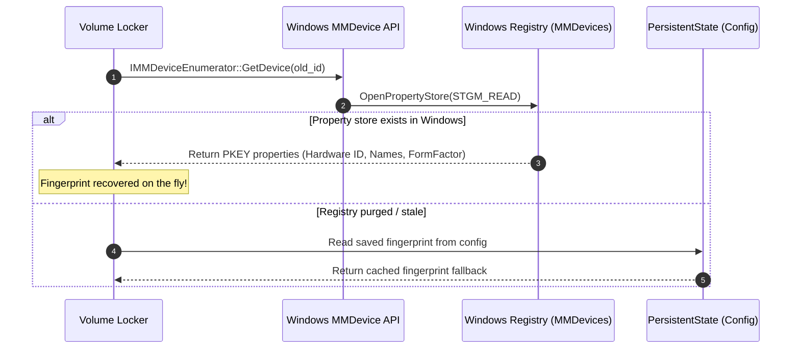
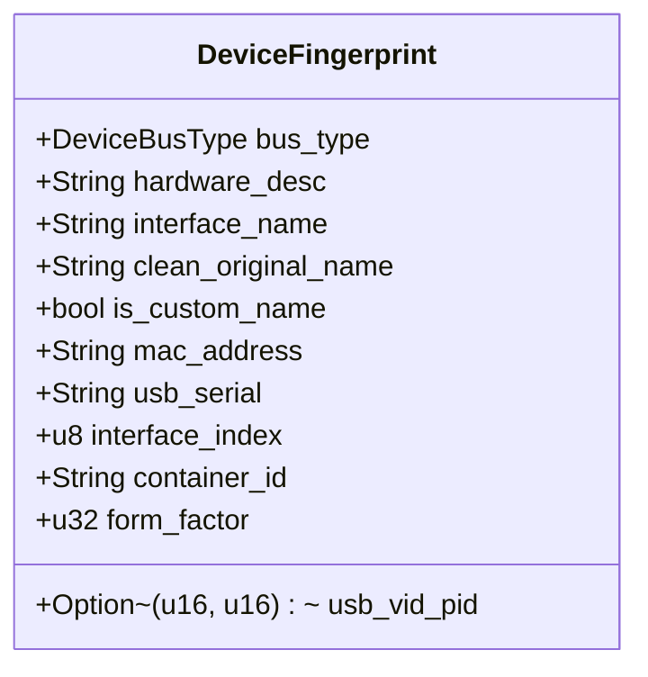
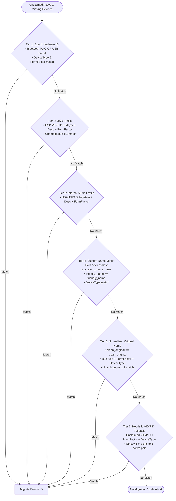
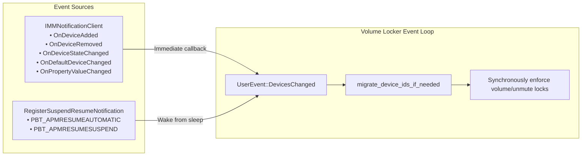
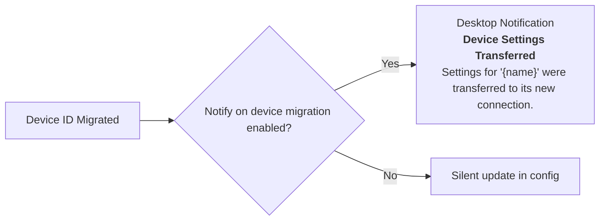

# Device ID Migration Architecture

This document describes how **Volume Locker** reliably tracks audio devices and migrates user configurations (volume locks, unmute locks, and priority lists) when Windows changes their endpoint IDs.

---

## The Problem

Windows Core Audio (WASAPI) identifies audio endpoints using ephemeral GUIDs:
- Output: `{0.0.0.00000000}.{GUID}`
- Input: `{0.0.1.00000000}.{GUID}`

These GUIDs are frequently regenerated by the Windows `AudioEndpointBuilder` service:



---

## Architectural Overview

Volume Locker handles device ID changes via three components:



---

## 1. On-The-Fly Property Store Recovery

When a device is unplugged or re-enumerated, Windows marks the old endpoint as `DEVICE_STATE_NOTPRESENT` (`4`). While activating audio streams fails, **Windows preserves the complete COM property store in the registry**:



Because of this, Volume Locker does not require prior fingerprints to migrate an existing device.

---

## 2. Hardware Fingerprints

The `DeviceFingerprint` captures immutable hardware descriptors extracted from the endpoint's `IPropertyStore`:



- **Bluetooth (`BTHENUM`)**: 48-bit MAC address (`BD_ADDR`) extracted from the PnP interface string. Persists across unpairing and re-pairing.
- **USB (`USB`)**: Vendor ID, Product ID, sub-interface index (`MI_xx`), and serial number (distinguished from synthetic port topology hashes).
- **Display / Motherboard (`HDAUDIO`, `PCI`)**: Driver subsystem ID, monitor description, and form factor.
- **Form Factor (`PKEY_AudioEndpoint_FormFactor`)**: Prevents cross-migrating between different profiles (e.g. A2DP Stereo Headphones vs. HFP Hands-Free Headset, or Game vs. Chat audio channels).

---

## 3. Name Normalization & Anti-Cross-Matching

Windows derives the default friendly name from two driver properties:
$$\text{Friendly Name} = \text{DeviceDesc} + \text{" ("} + \text{DeviceInterface\_FriendlyName} + \text{")"}$$

When a user customizes a device name in Windows Sound Settings, Windows overrides only `PKEY_Device_FriendlyName`. The underlying descriptors remain untouched:

```mermaid
flowchart TD
    subgraph Inspection[Custom Name Detection]
        FN[PKEY_Device_FriendlyName]
        DD[PKEY_Device_DeviceDesc]
        IF[PKEY_DeviceInterface_FriendlyName]
        COMP{FriendlyName == DeviceDesc + ' (' + InterfaceName + ')'?}
        FN & DD & IF --> COMP
        COMP -->|No| CUSTOM[is_custom_name = true]
        COMP -->|Yes| DEFAULT[is_custom_name = false]
    end
```

### Safety Rules

1. **Anti-Cross-Matching**: Never match a custom friendly name against a driver's default name.
   - *Prevents:* A custom-named `"Speakers"` endpoint incorrectly matching a newly plugged `"Speakers (USB Audio Device)"`.
2. **Normalized Original Matching**: Windows PnP injects port prefixes (e.g. `"2- "`) and clone counters (e.g. `" (1)"`) into `DeviceInterface_FriendlyName` when devices are moved across USB ports. Normalization strips these before matching:

```mermaid
flowchart LR
    RAW["2- Logitech USB Headset (1)"] -->|Strip '^\d+\s*-\s*'| S1["Logitech USB Headset (1)"]
    S1 -->|Strip '\s*\(\d+\)$'| CLEAN["Logitech USB Headset"]
```

---

## 4. The 6-Tier Migration Cascade

Volume Locker compares **missing registered devices** against **unclaimed active devices** through six prioritized confidence tiers:



### Collision Rejection
For non-serial USB devices or shared original names (e.g. two identical microphones or generic audio dongles), Volume Locker **never guesses**. If multiple missing or active candidates qualify for Tiers 2, 5, or 6, migration is rejected to prevent swapping settings between identical peripherals.

---

## 5. Event Triggers & Power Resume Architecture

Device ID migrations and volume locks are completely event-driven with zero periodic polling:



- **`OnPropertyValueChanged`**: Fires when a user renames an endpoint in Windows Sound Settings, allowing immediate migration without app restarts.
- **Power Resume**: Handles modern standby and system sleep wakeups, synchronously clamping volume levels in case Windows audio drivers reset endpoint volumes on wake.

---

## 6. User Notifications

When a migration occurs and the user has enabled **Notify on device migration** under `Preferences`:


