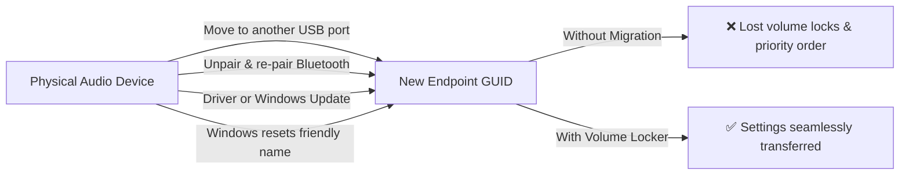
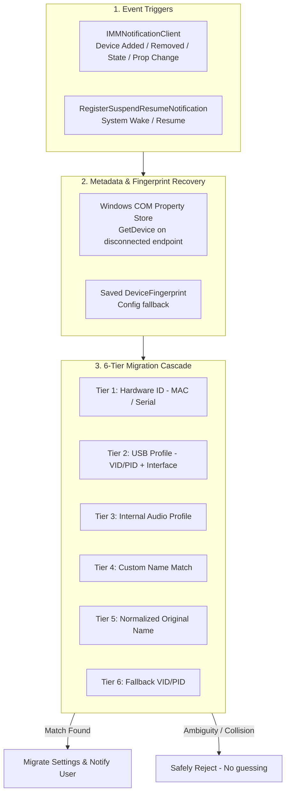
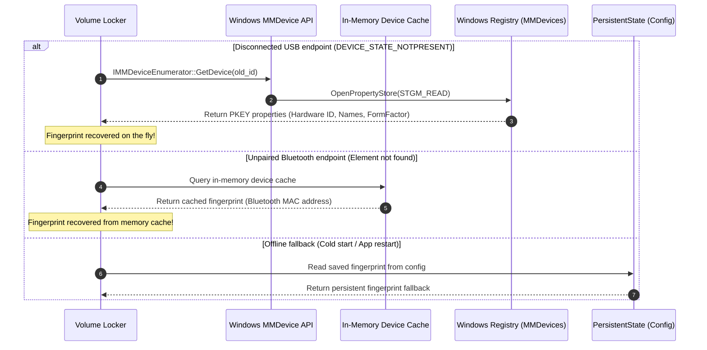
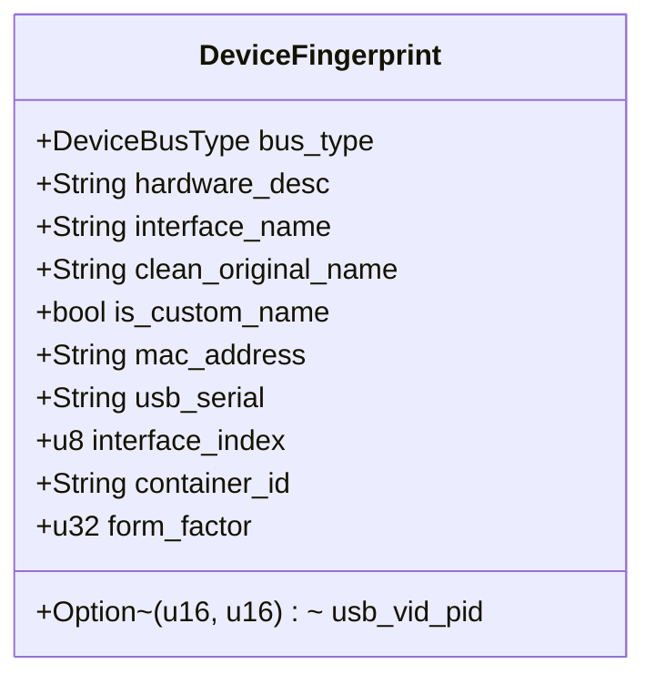
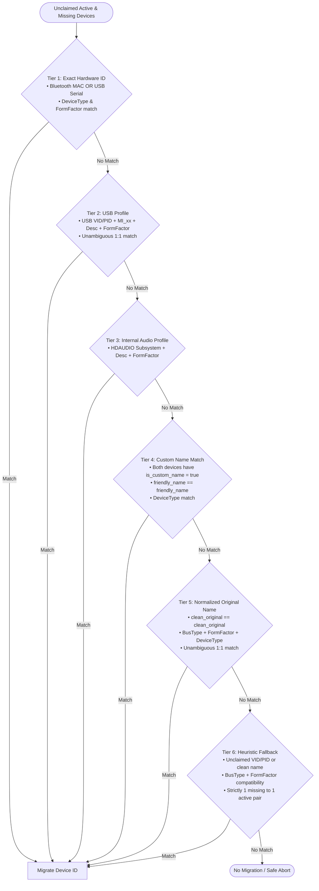
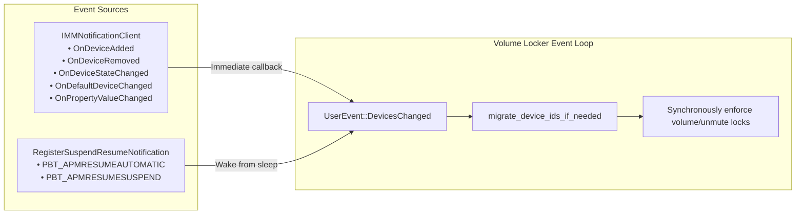
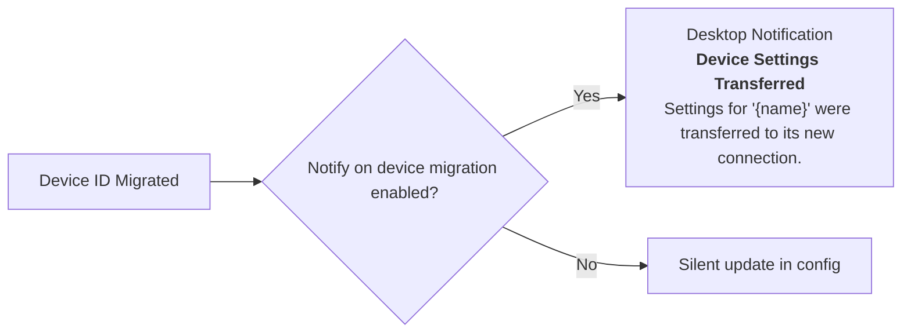

# Device ID migration

When Windows changes an audio endpoint ID, Volume Locker finds the same physical device and moves its volume locks, unmute locks, and priority list entries to the new ID.

## The problem

Windows Core Audio (WASAPI) identifies audio endpoints using ephemeral GUIDs:

- Output: `{0.0.0.00000000}.{GUID}`
- Input: `{0.0.1.00000000}.{GUID}`

The Windows `AudioEndpointBuilder` service often regenerates these GUIDs:



## Overview

Volume Locker handles device ID changes in three stages:



## 1. Recovering the fingerprint

When a USB device is unplugged or re-enumerated, Windows moves the old endpoint to `DEVICE_STATE_NOTPRESENT` (`4`). Audio streams can no longer be activated on it, but Windows keeps the complete COM property store in the registry.

When a Bluetooth device is unpaired in Windows Settings, Windows deletes the endpoint (`0x80070490 Element not found`). To cover this, Volume Locker keeps an in-memory `device_cache` of all active endpoints:



Settings can therefore migrate across Bluetooth unpairing and USB port changes.

## 2. Hardware fingerprints

`DeviceFingerprint` holds hardware descriptors extracted from the endpoint's `IPropertyStore`:



- **Bluetooth (`BTHENUM`)**: 48-bit MAC address (`BD_ADDR`) from the PnP interface string. It persists across unpairing and re-pairing.
- **USB (`USB`)**: Vendor ID, Product ID, sub-interface index (`MI_xx`), and serial number (distinguished from synthetic port topology hashes).
- **Display / Motherboard (`HDAUDIO`, `PCI`)**: Driver subsystem ID, monitor description, and form factor.
- **Form factor (`PKEY_AudioEndpoint_FormFactor`)**: Prevents migrating between different profiles (e.g. A2DP Stereo Headphones vs. HFP Hands-Free Headset, or Game vs. Chat audio channels).

## 3. Name normalization and cross-matching

Windows derives the default friendly name from two driver properties:
$$\text{Friendly Name} = \text{DeviceDesc} + \text{" ("} + \text{DeviceInterface\_FriendlyName} + \text{")"}$$

When a user renames a device in Windows Sound Settings, Windows changes only `PKEY_Device_FriendlyName`. The underlying descriptors stay the same:

```mermaid
flowchart TD
    subgraph Inspection[Custom Name Detection]
        FN[PKEY_Device_FriendlyName]
        DD[PKEY_Device_DeviceDesc]
        IF[PKEY_DeviceInterface_FriendlyName]
        COMP{FriendlyName == DeviceDesc + ' (' + InterfaceName + ')'?}
        FN & DD & IF --> COMP
        COMP -->|No| CUSTOM[is_custom_name = true]
        COMP -->|Yes| DEFAULT[is_custom_name = false]
    end
```

### Safety rules

1. **Cross-matching**: A custom friendly name is never matched against a driver's default name.
   - _Prevents:_ A custom-named `"Speakers"` endpoint incorrectly matching a newly plugged `"Speakers (USB Audio Device)"`.
2. **Normalized original names**: Windows PnP adds port prefixes (e.g. `"2- "`) and clone counters (e.g. `" (1)"`) into `DeviceInterface_FriendlyName` when devices are moved across USB ports. Normalization strips these before matching:

```mermaid
flowchart LR
    RAW["2- Logitech USB Headset (1)"] -->|Strip '^\d+\s*-\s*'| S1["Logitech USB Headset (1)"]
    S1 -->|Strip '\s*\(\d+\)$'| CLEAN["Logitech USB Headset"]
```

3. **Bus type and VID/PID**: Endpoints on different hardware buses (e.g. motherboard `HDAUDIO` vs. `USB` or `Bluetooth`) or with conflicting USB VID/PIDs never match, in any tier.
   - _Prevents:_ Motherboard speakers named `"Speakers"` from cross-migrating onto a newly attached USB or Bluetooth speaker.
4. **Devices in use**: Active endpoints already in a priority list or an active temporary priority are excluded from the candidates.
   - _Prevents:_ Devices already assigned from being overwritten as migration targets.

## 4. The 6-tier migration cascade

Volume Locker compares missing registered devices against unclaimed active devices in six tiers, highest confidence first:



### Collision rejection

USB devices without a serial, or devices sharing an original name (e.g. two identical microphones or generic audio dongles), can look the same. If several missing or active candidates qualify for Tiers 2, 5, or 6, the migration is rejected, so settings are never swapped between identical devices.

## 5. Event triggers and power resume

Device ID migrations and volume locks are event-driven, with no periodic polling:



- **`OnPropertyValueChanged`**: Filtered to `PKEY_Device_FriendlyName`, so it only acts when a user renames an endpoint in Windows Sound Settings. Driver telemetry (volume, battery, routing, peak meters) is ignored.
- **Event coalescing**: Bursts of hardware events while a device connects (e.g. `OnDeviceAdded`, `OnDeviceStateChanged`, `OnDefaultDeviceChanged`) become a single event loop dispatch.
- **Event attribution**: Windows callbacks pass the affected `DeviceId` and state transition to the event loop, so logs can name them without blocking COM threads.
- **Power resume**: On wake from modern standby or system sleep, volume levels are enforced synchronously, in case audio drivers reset endpoint volumes.

## 6. Notifications

When a migration occurs and the user has enabled **Notify on device migration** under `Preferences`:


