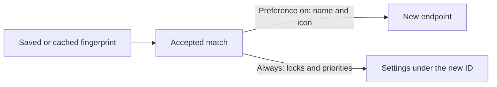

# Transferring names and icons

Volume Locker transfers a device's Windows name and icon along with its settings. To turn this off, uncheck **Also transfer device name and icon** under **Preferences** > **Settings transfer**. It needs **Automatically transfer device settings** to be on.

When Windows creates a new endpoint for a device, the endpoint gets a default name and icon. Volume Locker writes the device's last seen name and icon to the new endpoint.

## Why you might turn it off

1. It relies on an undocumented Windows interface. Microsoft's [Core Audio documentation](https://learn.microsoft.com/en-us/windows/win32/coreaudio/audio-endpoint-properties) says clients should read endpoint properties and not set them.
2. It can replace older names. Windows may reuse an earlier endpoint when a device returns to a port it used before, and the last seen name and icon replace whatever that endpoint had.
3. A copied icon only works while its file or resource still exists on the system.

## What gets copied

| Value | Property                    | Example                                                       |
| ----- | --------------------------- | ------------------------------------------------------------- |
| Name  | `PKEY_Device_DeviceDesc`    | `Speakers`                                                    |
| Icon  | `PKEY_DeviceClass_IconPath` | `C:\Icons\headset.ico` or `%windir%\system32\mmres.dll,-3014` |

The icon value is a reference, so the image itself is not copied. Volume Locker does not copy driver descriptions, hardware identity, form factor, or any other property.

Volume Locker does not try to detect custom names or icons. It stores the current values in the device's fingerprint each time it sees a tracked device, and restores them as they are. A value is only written when it differs from the new endpoint's value.

## How it runs

1. The [matching tiers](./settings-transfer.md#matching-tiers) accept a pair. The name and icon do not affect matching.
2. `IPolicyConfig::SetPropertyValue` writes each changed value as a `VT_LPWSTR` string.
3. Volume locks, unmute locks, and priorities move to the new ID.

## If a write fails

Volume Locker logs a warning with both endpoint IDs, and the settings still transfer. It does not elevate privileges, edit the registry, or undo the match. Windows may also replace a written value later.
