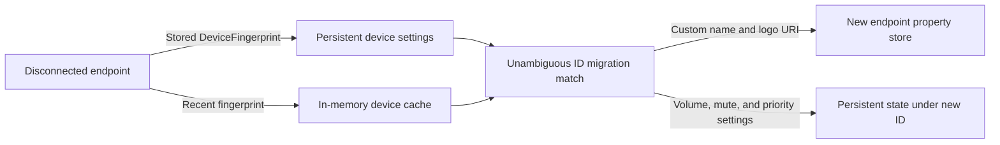

# Windows Audio Endpoint Property Migration

This document describes how Volume Locker carries a user's Windows-assigned audio endpoint name and logo across an endpoint ID migration. It complements [Device ID Migration Architecture](./device-id-migration.md), which documents how the old and new endpoints are matched.

## Scope

Windows associates endpoint properties with an audio endpoint ID. When Windows creates a replacement endpoint for the same physical device, the new endpoint may have a different ID and default properties. Once the device-ID migration matcher has made an unambiguous match, Volume Locker attempts to carry over:

- The custom endpoint name from `PKEY_Device_FriendlyName`.
- The endpoint logo URI from `PKEY_AudioEndpointLogo_IconPath`.

The logo property is a URI, commonly a resource specifier such as `@driverresource.dll,-200`; Volume Locker migrates that reference, not the image bytes or the driver resource itself.

## Data flow

`DeviceFingerprint` holds the raw custom name and logo URI in addition to the hardware identity used by the matcher. It is saved with each device's settings and also included in the in-memory device cache. Thus the source properties can still be available after Windows has removed the old endpoint, including when a Bluetooth device is unpaired. The existing recovery order remains unchanged: saved fingerprint, in-memory cache, then a property-store lookup for the old endpoint.

The custom name is kept in its raw Windows form for writing back to the endpoint; the existing cleaned `DeviceSettings.name` remains the user-facing name used by Volume Locker. For older saved state that has `is_custom_name` but no raw custom name, migration falls back to the saved device name. Older state without a fingerprint remains valid because the new fingerprint fields are optional and default to absent.

## Migration sequence

1. Device change handling runs the existing fingerprint and six-tier ID matcher.
2. The matcher rejects ambiguous pairs and excludes devices already claimed by current settings or priority lists.
3. For an accepted pair, migration asks the Windows audio backend to restore whichever source custom properties are present on the new endpoint.
4. The backend uses the existing Windows `IPolicyConfig` endpoint configuration interface to set the friendly name and/or logo URI as `VT_LPWSTR` values.
5. The existing app-state migration moves device settings, persistent priorities, and temporary priorities to the new ID.

This property restoration does not participate in matching and cannot cause an ambiguous migration to be accepted.

## Failure behavior and platform boundary

Windows owns audio endpoint properties. Microsoft's Core Audio documentation says clients can read endpoint properties but should not set them; the existing `IPolicyConfig` COM interface used here is undocumented and Windows may reject a write or later replace a value. Restoration is best-effort: a property-write failure is logged with both endpoint IDs, while the independent Volume Locker settings and priority migration still completes. The app does not elevate privileges, edit the registry directly, or roll back a successful device-ID match because a property write failed.

The backend operation is deliberately limited to the two properties above. Driver descriptions, hardware identity, form factor, and other endpoint metadata are not copied from the old endpoint, so the new endpoint keeps its own hardware properties. A copied logo URI is only useful if its referenced resource remains available on the system.

## References

- [Audio Endpoint Properties (Microsoft Learn)](https://learn.microsoft.com/en-us/windows/win32/coreaudio/audio-endpoint-properties) — endpoint properties are system-managed and clients should read, not set, them.
- [PKEY_Device_FriendlyName (Microsoft Learn)](https://learn.microsoft.com/en-us/windows/win32/coreaudio/pkey-device-friendlyname) — friendly-name property and `VT_LPWSTR` representation.
- Windows SDK `mmdeviceapi.idl` — defines `PKEY_AudioEndpointLogo_IconPath` as a `VT_LPWSTR` URI property.
