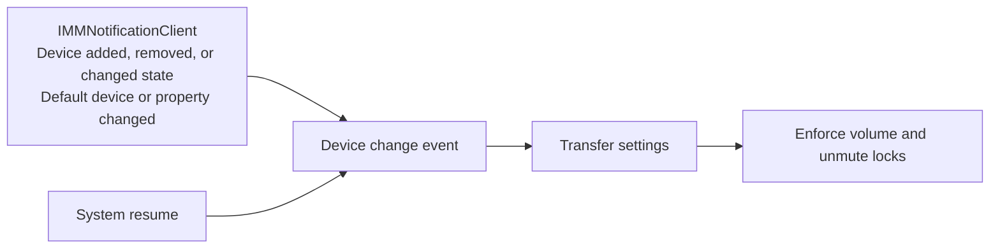

# Settings transfer

When Windows gives an audio device a new endpoint ID, Volume Locker finds the same physical device and transfers its volume lock, unmute lock, and priority list entries to the new ID. This is on by default. To turn it off, uncheck **Automatically transfer device settings** under **Preferences** > **Settings transfer**. To get a notification when it happens, check **Notify on settings transfer**.

To also transfer the device's Windows name and icon, see [Transferring names and icons](./device-names-and-icons.md).

## When endpoint IDs change

Windows identifies each audio endpoint with a GUID:

- Output: `{0.0.0.00000000}.{GUID}`
- Input: `{0.0.1.00000000}.{GUID}`

The Windows `AudioEndpointBuilder` service can create a new GUID when you:

1. Plug a device into another USB port.
2. Unpair and re-pair a Bluetooth device.
3. Update a driver or Windows.

## How a transfer runs

Transfers run on audio events, with no periodic polling:

1. Volume Locker finds tracked devices whose endpoint is no longer active.
2. It recovers each missing device's fingerprint.
3. It compares missing devices with unclaimed active devices through the five matching tiers.
4. It transfers the settings of each accepted match to the new ID and saves them.

Each event also saves any change to a tracked device's name or fingerprint.

`OnPropertyValueChanged` only acts on `PKEY_Device_DeviceDesc` (a rename) and `PKEY_DeviceClass_IconPath` (an icon change). It ignores other property changes, such as volume, battery, and routing.

On wake from sleep, volume levels are enforced right away, in case a driver reset them.

## Recovering the fingerprint

A missing device's fingerprint comes from the first of these that has one:

1. The fingerprint saved with the device's settings.
2. The in-memory `device_cache`, which holds every active endpoint seen since the app started.
3. The Windows property store of the old endpoint.

Windows usually keeps a disconnected endpoint as `DEVICE_STATE_NOTPRESENT`, and its property store stays readable. It can also delete the endpoint (`0x80070490 Element not found`), which can happen some time after a Bluetooth device is unpaired.

## What a fingerprint holds

| Field                          | Source                                                          |
| ------------------------------ | --------------------------------------------------------------- |
| `mac_address`                  | Bluetooth address in the PnP interface path                     |
| `usb_vid_pid`, `usb_serial`    | USB identifiers in the PnP interface path                       |
| `interface_index`              | USB `MI_xx` value in the PnP interface path                     |
| `bus_type`, `container_id`     | Enumerator name and `PKEY_Device_ContainerId`                   |
| `form_factor`                  | `PKEY_AudioEndpoint_FormFactor`, for example speaker or headset |
| `device_desc`, `icon_path`     | `PKEY_Device_DeviceDesc` and `PKEY_DeviceClass_IconPath`        |
| `interface_name`, `clean_name` | `PKEY_DeviceInterface_FriendlyName` and the composed name       |

A rename changes `device_desc` and `clean_name`, so they can tell endpoints apart but cannot prove two endpoints are the same device. `usb_serial` is only set when the value is a real serial number, and not a port hash from Windows.

## How device names are built

Volume Locker never reads `PKEY_Device_FriendlyName`. Windows computes that value from the two properties below, does not store it, and sends no notification when it changes. This also means Volume Locker cannot tell a custom name from a driver's default name.

`compose_device_name` builds the name as `"{DeviceDesc} ({DeviceInterface_FriendlyName})"`:

- `PKEY_Device_DeviceDesc` is the endpoint name. Renaming a device in Windows changes this property.
- `PKEY_DeviceInterface_FriendlyName` is the adapter name. Renaming a device does not change it.

Windows can add a port prefix (`2- `) or a clone counter (` (1)`) to these values. Volume Locker removes them:

## Matching tiers

Volume Locker tries each tier in order, highest confidence first:

| Tier | Name                           | A missing and an active device match when                                                                                                                       |
| ---- | ------------------------------ | --------------------------------------------------------------------------------------------------------------------------------------------------------------- |
| 1    | Exact hardware ID              | They have the same Bluetooth MAC address, or the same USB serial number and VID/PID                                                                             |
| 2    | Hardware profile and interface | Both are USB, with the same VID/PID and `MI_xx`                                                                                                                 |
| 3    | Internal hardware profile      | They share a container other than the system container and have the same adapter name, or both are HD Audio or share a container and have the same `DeviceDesc` |
| 4    | Normalized name                | They have the same `clean_name`                                                                                                                                 |
| 5    | Heuristic fallback             | They have the same device name, or the same VID/PID                                                                                                             |

### Rules for every tier

1. Both devices must be the same type, output or input.
2. If both have a form factor, a bus type, a USB VID/PID, an `MI_xx` value, or a USB serial number, each of those must match. This keeps motherboard speakers named `Speakers` from matching a new USB speaker, and one headset channel from matching another.
3. Active devices already in tracked settings, a priority list, or a temporary priority are not candidates.
4. A match must be one to one. If several devices qualify, that tier skips them and the next tier tries, so settings do not transfer between identical devices.

### Renamed devices

Tiers 1 and 2 ignore the name. Tier 3 only ignores it when both endpoints share a container other than the system container (`{00000000-0000-0000-FFFF-FFFFFFFFFFFF}`), because Windows uses that one for unrelated endpoints.

A renamed endpoint in the system container matches no tier if Windows re-creates it with its default name, so its settings do not transfer.

## Notification

If **Notify on settings transfer** is checked, each transferred device shows this notification:

> **Device Settings Transferred**
> Settings for '{name}' were transferred to its new connection.
